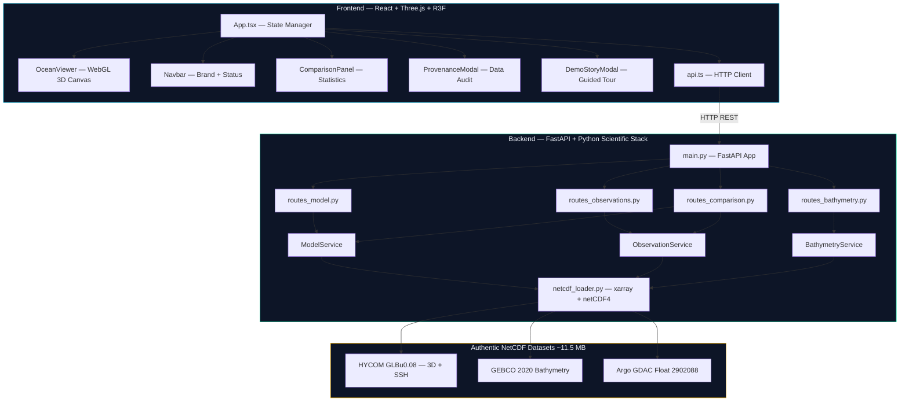

<div align="center">

# 🌊 VARUNA — Ocean 3D Digital Twin

### Interactive 3D Oceanographic Visualization & Model-Observation Validation Platform

[](https://python.org)
[](https://typescriptlang.org)
[](https://react.dev)
[](https://threejs.org)
[](https://fastapi.tiangolo.com)
[]()

**[Repository](https://github.com/paraspalawat/VARUNA)** · **[Author](https://paraspalawat.me/)**

---

*A scientific platform that bridges numerical ocean circulation models with autonomous in-situ observations, enabling 4D spatial visualization, collocated statistical validation, and interactive deep-ocean exploration across the Indian Ocean basin.*

</div>

---

## 📖 Overview

**VARUNA** (named after the Vedic deity of oceans and cosmic order) is a full-stack, browser-based **3D ocean digital twin** platform designed for the **Indian Ocean basin** (30°E–115°E, 25°S–30°N).

It addresses a fundamental challenge in operational oceanography: **How do we meaningfully compare gridded numerical ocean model predictions against sparse, point-sampled autonomous observations in a single unified interface?**

VARUNA integrates:
- **HYCOM GLBu0.08** (Hybrid Coordinate Ocean Model) 3D circulation fields — temperature, salinity, currents, sea surface height
- **GEBCO 2020** global bathymetric grid — authentic seafloor topography
- **Argo GDAC** autonomous profiling float CTD observations — in-situ temperature & salinity profiles

The platform renders these heterogeneous datasets as an interactive WebGL 3D scene with real-time depth slicing, temporal scrubbing, statistical collocation, and scientific provenance tracking — all accessible through a modern, production-grade web interface.

### Who is VARUNA for?

| Audience | Use Case |
|----------|----------|
| **Oceanographers** | Validate numerical models against Argo observations |
| **Researchers** | Explore thermocline structure, current patterns, and SSH anomalies |
| **Students** | Interactive learning of physical oceanography concepts |
| **Data Scientists** | Understand model-observation collocation methodology |
| **Portfolio Reviewers** | Evaluate full-stack 3D scientific visualization capabilities |

---

## ✨ Key Features

### 🌐 3D Seafloor Bathymetry
- Displaced terrain mesh rendered from **GEBCO 2020** gridded bathymetry data
- Captures major features: Central Indian Ridge, Ninety East Ridge, Carlsberg Ridge, Java Trench
- 0.5° resolution (171 × 111 grid), elevation range: −6808 m to +5869 m

### 🌡️ 4D Ocean Model Slicing
- Interactive horizontal slicing across **4 physical variables**:
  - **Potential Temperature** (°C) — Turbo colormap
  - **Practical Salinity** (PSU) — Haline colormap
  - **Current Velocity Magnitude** (m/s) — Viridis colormap
  - **Sea Surface Height Anomaly** (m) — Coolwarm colormap
- Vertical depth exploration: 10+ presets from surface to 2000 m
- Temporal scrubbing: 3 daily HYCOM snapshots (18–20 November 2018)
- Surface locking for SSH (z = 0 m constraint)

### 🌊 Current Velocity Vectors
- 3D flow arrows derived from zonal (U) and meridional (V) HYCOM velocity components
- Direction: atan2(V, U) · Magnitude: √(U² + V²)
- Dynamic scaling with velocity magnitude

### 📡 In-Situ Observation Network
- **Argo profiling float** WMO 2902088: 228 ascent cycles, CTD profiles to 2000 m
- Surface markers with vertical profile visualization
- Autonomous underwater glider mission trajectories (sawtooth 3D paths)

### 📊 Model vs Observation Collocation & Comparison
- **Statistical validation**: RMSE, MAE, Mean Bias across collocated depth levels
- **Temporal classification**:
  - **NEAR-SYNOPTIC** (|Δt| ≤ 24h) — valid scientific comparison
  - **TEMPORALLY MISMATCHED** (|Δt| > 24h) — flagged to prevent invalid conclusions
- Multi-cycle selection: Cycle 217 (synoptic) vs Cycle 228 (mismatched)
- Haversine-based horizontal collocation with great-circle distance reporting

### 📋 Scientific Data Provenance
- Full provenance tracking for HYCOM, GEBCO, and Argo datasets
- Authentic vs synthetic fallback classification
- QC flag filtering (flags 1 and 2 accepted for Argo)
- Real-time dataset health diagnostics

### 🎥 Presentation Mode
- Clean fullscreen 3D view — hides side panels for projection/demonstration
- Guided story walkthrough with 6 narrated scientific steps
- 1-click scientific workflow stepper

### 🌐 Offline Capability
- High-fidelity cached simulation when backend is unreachable
- Honest provenance banners distinguish real data from synthetic fallback
- Graceful degradation with informative status indicators

---

## 🏗️ System Architecture



### Communication Flow

1. **Frontend** renders the 3D scene via React Three Fiber and manages application state in `App.tsx`
2. **API Client** (`api.ts`) dispatches REST requests with stale-state request sequencing (race condition protection)
3. **FastAPI Backend** routes requests to domain-specific services (model, observation, bathymetry, comparison)
4. **Services** delegate to `netcdf_loader.py`, which ingests authentic NetCDF datasets using `xarray` and `netCDF4`
5. **Comparison endpoint** performs horizontal collocation (Haversine), vertical depth matching, and statistical metric computation

---

## 🛠️ Technology Stack

| Layer | Technology | Purpose |
|-------|-----------|---------|
| **Frontend Framework** | React 18.3 + TypeScript 5.3 | Component architecture & type safety |
| **3D Rendering** | Three.js r160 + React Three Fiber 8.x | WebGL ocean scene, bathymetry mesh, flow vectors |
| **3D Utilities** | @react-three/drei 9.x | Camera controls, helpers, and 3D primitives |
| **UI Icons** | Lucide React | Scientific iconography |
| **Build Tool** | Vite 5.2 | HMR development server & production bundler |
| **Backend Framework** | FastAPI 0.110+ | High-performance async REST API |
| **Data Processing** | xarray, netCDF4, NumPy, Pandas | NetCDF ingestion, slicing, and scientific computation |
| **Data Validation** | Pydantic 2.6+ | Request/response schema validation |
| **ASGI Server** | Uvicorn | Production-grade async server |
| **HTTP Client** | HTTPX | Async backend HTTP operations |
| **Containerization** | Docker | Multi-platform deployment |
| **CI/CD** | GitHub Actions | Automated build & GitHub Pages deployment |
| **Cloud Hosting** | Render / Railway / Cloud Run | Backend deployment options |

---

## 📁 Repository Structure

```
VARUNA/
├── backend/
│   ├── app/
│   │   ├── api/                    # FastAPI route handlers
│   │   │   ├── routes_model.py     # Ocean model slice & metadata endpoints
│   │   │   ├── routes_observations.py  # Argo float & glider data endpoints
│   │   │   ├── routes_bathymetry.py    # GEBCO bathymetry grid endpoint
│   │   │   └── routes_comparison.py    # Model vs observation collocation
│   │   ├── core/
│   │   │   └── config.py           # Domain bounds, depth levels, variable specs
│   │   ├── models/
│   │   │   └── schemas.py          # Pydantic response models
│   │   ├── services/
│   │   │   ├── model_service.py    # HYCOM model data service
│   │   │   ├── observation_service.py  # Argo float service
│   │   │   └── bathymetry_service.py   # GEBCO bathymetry service
│   │   └── main.py                 # FastAPI application entry point
│   ├── data/
│   │   └── netcdf_loader.py        # xarray + netCDF4 data ingestion engine
│   ├── tests/                      # 77 automated tests across 10 suites
│   │   ├── run_all_tests.py        # Unified test runner
│   │   ├── test_api.py             # API route smoke tests
│   │   ├── test_argo_loader.py     # Argo NetCDF parsing & QC validation
│   │   ├── test_bathymetry_loader.py   # GEBCO parsing & coordinate tests
│   │   ├── test_ocean_model_loader.py  # HYCOM 3D model tests
│   │   ├── test_ssh_loader.py      # SSH parsing & surface locking
│   │   ├── test_multi_cycle_comparison.py  # Multi-cycle Argo handling
│   │   ├── test_phase3c_comparison.py  # Collocation metrics validation
│   │   ├── test_phase3d_storytelling.py  # State summary & vector math
│   │   ├── test_phase4_hardening.py    # Health diagnostics & safety
│   │   └── test_provenance_status.py   # Provenance verification
│   └── requirements.txt
├── frontend/
│   ├── src/
│   │   ├── components/             # 18 React components
│   │   │   ├── OceanViewer.tsx     # Main 3D WebGL canvas
│   │   │   ├── BathymetryMesh.tsx  # GEBCO terrain renderer
│   │   │   ├── OceanSurfaceLayer.tsx   # Model slice visualizer
│   │   │   ├── CurrentVectors.tsx  # Flow arrow renderer
│   │   │   ├── ObservationLayer.tsx    # Argo float & glider markers
│   │   │   ├── ComparisonPanel.tsx # Statistical comparison modal
│   │   │   ├── Navbar.tsx          # Application header & status
│   │   │   └── ...                 # Additional UI components
│   │   ├── services/
│   │   │   └── api.ts              # REST client with request sequencing
│   │   ├── types/
│   │   │   └── ocean.ts            # TypeScript domain interfaces
│   │   ├── App.tsx                 # Application state & layout
│   │   └── index.css               # Complete design system (1900+ lines)
│   ├── index.html                  # HTML entry point
│   ├── package.json
│   ├── vite.config.ts
│   └── tsconfig.json
├── data/
│   └── raw/                        # Authentic NetCDF datasets
│       ├── models/
│       │   ├── hycom_indian_ocean.nc       # HYCOM 3D fields (9.22 MB)
│       │   └── hycom_ssh_indian_ocean.nc   # HYCOM SSH (66 KB)
│       ├── bathymetry/
│       │   └── gebco_2020_indian_ocean.nc  # GEBCO elevation (44 KB)
│       └── argo/
│           └── 2902088_prof.nc             # Argo CTD profiles (2.0 MB)
├── docs/                           # Technical architecture documentation
│   ├── architecture.md
│   ├── data-flow.md
│   ├── dataset-plan.md
│   ├── implementation-plan.md
│   └── real-data-integration.md
├── .github/workflows/
│   └── deploy.yml                  # GitHub Pages CI/CD workflow
├── Dockerfile                      # Multi-platform container build
├── Procfile                        # PaaS deployment command
├── render.yaml                     # Render.com service configuration
├── start_backend.bat               # Windows backend launcher
├── start_frontend.bat              # Windows frontend launcher
├── run_tests.bat                   # Windows test runner
└── README.md
```

---

## ⚡ Installation & Setup

### Prerequisites

| Tool | Version | Purpose |
|------|---------|---------|
| **Python** | 3.10+ (recommended 3.11) | Backend runtime |
| **Node.js** | v18+ (recommended v20+) | Frontend runtime |
| **npm** | v9+ | Package management |
| **Git** | 2.x | Version control |

### 1. Clone the Repository

```bash
git clone https://github.com/paraspalawat/VARUNA.git
cd VARUNA
```

### 2. Backend Setup

```bash
cd backend
python -m pip install -r requirements.txt
```

### 3. Frontend Setup

```bash
cd frontend
npm install
```

### 4. Environment Configuration

The frontend uses a Vite proxy in development, so no manual `.env` configuration is typically needed for local use.

For custom backend URLs, copy the example environment file:

```bash
cd frontend
cp .env.example .env.development
```

Edit `VITE_API_BASE` if your backend runs on a different host/port.

**`.env.example` template:**
```env
# VARUNA — Ocean 3D Digital Twin — Environment Configuration
# Backend API Base URL
VITE_API_BASE=http://127.0.0.1:8000/api
```

---

## 🚀 Running VARUNA

### Quick Start (Windows)

```bash
# Terminal 1 — Backend
start_backend.bat

# Terminal 2 — Frontend
start_frontend.bat
```

### Manual Start

#### Start the Backend (FastAPI)

```bash
cd backend
python -m uvicorn app.main:app --host 127.0.0.1 --port 8000 --reload
```

- **API Base**: `http://127.0.0.1:8000`
- **Swagger Docs**: `http://127.0.0.1:8000/docs`
- **ReDoc**: `http://127.0.0.1:8000/redoc`

#### Start the Frontend (Vite + React)

```bash
cd frontend
npm run dev
```

- **Application**: `http://localhost:5173`
- **API Proxy**: Requests to `/api/*` are proxied to `http://127.0.0.1:8000`

> **Note**: Start the backend first. The frontend gracefully handles offline mode if the backend is unavailable, displaying a cached simulation with provenance notices.

---

## 🔬 Data & Scientific Components

### Authentic Datasets

All datasets are authentic, sourced from authoritative oceanographic archives, and tracked directly in Git under `data/raw/` (~11.5 MB total):

| Dataset | Source Institution | File | Specs |
|---------|-------------------|------|-------|
| **HYCOM 3D** | NOAA / NRL HYCOM+NCODA (GLBu0.08, expt 91.2) | `data/raw/models/hycom_indian_ocean.nc` | 89×58 grid, 39 depth levels, 3 daily steps. Variables: `water_temp`, `salinity`, `water_u`, `water_v` |
| **HYCOM SSH** | NOAA / NRL HYCOM+NCODA | `data/raw/models/hycom_ssh_indian_ocean.nc` | 89×58 grid, surface, 3 daily steps. Variable: `surf_el` |
| **GEBCO 2020** | BODC / GEBCO | `data/raw/bathymetry/gebco_2020_indian_ocean.nc` | 171×111 grid, 0.5° resolution. Range: −6808 m to +5869 m |
| **Argo GDAC** | Ifremer / Coriolis GDAC | `data/raw/argo/2902088_prof.nc` | WMO 2902088, 228 cycles. In-situ T/S with UNESCO depth conversion, QC flags 1 & 2 |

### Collocation Methodology

1. **Horizontal Collocation**: Nearest HYCOM grid cell to Argo position via Haversine great-circle distance
2. **Vertical Matching**: Each Argo depth matched to nearest native HYCOM depth level
3. **Statistical Metrics**:
   - **Signed Error**: Error_i = Model_i − Obs_i
   - **Mean Bias**: (1/N) Σ (Model_i − Obs_i)
   - **MAE**: (1/N) Σ |Model_i − Obs_i|
   - **RMSE**: √[(1/N) Σ (Model_i − Obs_i)²]
4. **Temporal Classification**: Synoptic alignment flag based on |Δt| threshold (24 hours)

---

## 📡 API Documentation

The backend exposes a RESTful API. Full interactive documentation is available via Swagger UI at `/docs`.

### Core Endpoints

| Method | Endpoint | Description |
|--------|----------|-------------|
| `GET` | `/api/health` | System health check with dataset status |
| `GET` | `/api/health/datasets` | Detailed dataset availability diagnostics |
| `GET` | `/api/metadata` | Grid dimensions, depth levels, time steps |
| `GET` | `/api/slice/{variable}` | 2D model field at specified depth & time |
| `GET` | `/api/bathymetry` | GEBCO bathymetry grid data |
| `GET` | `/api/observations/argo` | Argo float positions & profiles |
| `GET` | `/api/observations/gliders` | Glider mission trajectories |
| `GET` | `/api/comparison/{float_id}` | Model vs observation collocation results |
| `GET` | `/api/provenance` | Dataset provenance & authenticity records |

### Example Request

```bash
# Get ocean temperature slice at 200m depth, time step 2
curl "http://127.0.0.1:8000/api/slice/temperature?depth=200&time_step=2"

# Get model vs Argo comparison for Cycle 217
curl "http://127.0.0.1:8000/api/comparison/argo-2902088?variable=temperature&cycle=217&time_step=2"
```

---

## 🧪 Testing & Validation

### Backend Test Suite (77 Tests, 10 Suites)

```bash
# Run complete test suite
python backend/tests/run_all_tests.py

# Or use the batch script (Windows)
run_tests.bat
```

| Suite | Tests | Coverage |
|-------|-------|----------|
| `test_api.py` | 8 | API route smoke tests |
| `test_argo_loader.py` | 6 | Argo NetCDF parsing, QC filtering, UNESCO depth conversion |
| `test_bathymetry_loader.py` | 5 | GEBCO parsing, coordinate orientation, caching |
| `test_ocean_model_loader.py` | 6 | HYCOM 3D model parsing, vertical profiling |
| `test_ssh_loader.py` | 8 | SSH parsing, temporal variation, surface locking |
| `test_multi_cycle_comparison.py` | 10 | Multi-cycle Argo handling, synoptic classification |
| `test_phase3c_comparison.py` | 10 | RMSE, MAE, Bias collocation metrics |
| `test_phase3d_storytelling.py` | 8 | State summary calculations, vector math |
| `test_phase4_hardening.py` | 8 | Health diagnostics, 404 safety, terminology audit |
| `test_provenance_status.py` | 8 | Authentic NetCDF provenance verification |

### Frontend Build Validation

```bash
cd frontend
npm run build
```

Verifies TypeScript compilation and production asset bundling with zero errors.

---

## 🐳 Deployment

### Docker

```bash
# Build
docker build -t varuna-backend .

# Run
docker run -p 8000:8000 varuna-backend
```

With custom CORS origin:
```bash
docker run -p 8000:8000 -e CORS_ORIGINS="https://yourdomain.com" varuna-backend
```

### Render.com

The included `render.yaml` provides one-click deployment configuration:
- **Runtime**: Python 3.11
- **Build**: `pip install -r backend/requirements.txt`
- **Start**: `uvicorn app.main:app --app-dir backend --host 0.0.0.0 --port $PORT`

### GitHub Pages (Frontend)

The `.github/workflows/deploy.yml` workflow automatically builds and deploys the frontend to GitHub Pages on push to `main`. Configure `VITE_API_BASE` as a repository variable to connect to a cloud backend.

### Heroku / Railway

```bash
# Uses the included Procfile
web: uvicorn app.main:app --app-dir backend --host 0.0.0.0 --port ${PORT:-8000}
```

---

## 🔧 Troubleshooting

| Issue | Solution |
|-------|----------|
| **Backend offline banner** | Ensure FastAPI is running on port 8000 before starting the frontend |
| **NetCDF import errors** | Install `netCDF4` and `HDF5` system libraries: `pip install netCDF4` |
| **Blank 3D scene** | Check browser WebGL support. Hardware acceleration must be enabled |
| **CORS errors in production** | Set `CORS_ORIGINS` env variable to your frontend domain |
| **Large file push rejected** | All datasets are <10 MB each, well within GitHub limits |
| **Port already in use** | Kill existing processes: `lsof -ti:8000 | xargs kill -9` (macOS/Linux) |

---

## 🗺️ Roadmap

> The following items are **planned future improvements**, not existing functionality.

- [ ] **Multi-basin support** — Extend beyond Indian Ocean to Atlantic and Pacific basins
- [ ] **Real-time data ingestion** — Live Argo/HYCOM data feeds via ERDDAP/OPeNDAP
- [ ] **Satellite SST overlay** — MODIS / VIIRS sea surface temperature integration
- [ ] **Advanced analytics** — Time series analysis, anomaly detection, trend computation
- [ ] **User annotations** — Custom markers, transects, and region-of-interest selection
- [ ] **Multi-user collaboration** — WebSocket-based shared visualization sessions
- [ ] **Mobile-responsive UI** — Optimized touch controls for tablet devices
- [ ] **Export capabilities** — Download slices, profiles, and comparison reports as CSV/JSON

---

## 🤝 Contributing

Contributions are welcome! To contribute:

1. **Fork** the repository
2. **Create** a feature branch: `git checkout -b feature/your-feature`
3. **Commit** with clear messages: `git commit -m "feat: add satellite SST overlay"`
4. **Push** to your fork: `git push origin feature/your-feature`
5. **Open** a Pull Request with a description of your changes

Please ensure:
- All existing tests pass (`python backend/tests/run_all_tests.py`)
- Frontend builds without errors (`cd frontend && npm run build`)
- Code follows existing patterns and conventions

---

## 📜 License

A license has not yet been specified for this project. Please contact the author for usage terms.

---

## 👤 Author

**Paras Palawat**

- 🌐 Portfolio: [paraspalawat.me](https://paraspalawat.me/)
- 🐙 GitHub: [@paraspalawat](https://github.com/paraspalawat)

---

<div align="center">

*Built with 🌊 for the ocean science community*

**[⬆ Back to Top](#-varuna--ocean-3d-digital-twin)**

</div>
